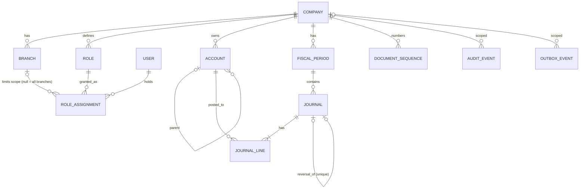

# Phase 1 ERD and migration review

Scope: `org`, `iam`, `platform` and `accounting` schemas. Conventions follow docs/DATA.md: UUID keys (`gen_random_uuid()`), UTC `timestamptz`, local business dates as `date`, `NUMERIC(20,6)` money, `version` for optimistic locking on mutable rows.

## Tables

| Table | Key columns | Integrity rules |
|---|---|---|
| `org.company` | code, legal_name(_ar), base_currency, timezone, status | unique lower(code); currency `^[A-Z]{3}$` |
| `org.branch` | company_id, code, name(_ar), status | unique (company_id, code); unique (company_id, id) as composite-FK target |
| `iam.user` | oidc_issuer, oidc_subject, email, is_platform_admin, status | unique (oidc_issuer, oidc_subject). No passwords are stored |
| `iam.role` | company_id, code, permissions text[] | unique (company_id, code); permissions validated against the code catalog |
| `iam.role_assignment` | company_id, user_id, role_id, branch_id? | **composite FKs** (company_id, role_id) and (company_id, branch_id), so a role or branch from another company cannot be used; unique (user, role, branch) NULLS NOT DISTINCT |
| `platform.audit_event` | actor, company, branch, action, entity, reason, before/after (redacted JSON), request_id | **append-only** (trigger blocks UPDATE/DELETE/TRUNCATE) |
| `platform.outbox_event` | event id (unique), aggregate, type, payload, published_at, attempts | written in the business transaction; the relay arrives in P1-11 |
| `platform.document_sequence` | (company_id, doc_type, series) → next_value | incremented with an atomic upsert inside the posting transaction, so numbers are gapless for committed documents |
| `accounting.account` | company_id, code, type, parent_id?, is_posting, status | composite FK to parent in the same company; unique (company_id, code) |
| `accounting.fiscal_period` | company_id, start_date, end_date, status | `EXCLUDE USING gist` prevents overlapping periods per company; dates frozen once journals exist; closed → open is not allowed (reopen needs the approval flow) |
| `accounting.journal` | company_id, branch_id?, number, posting_date, currency, totals, source_type/source_id, reversal_of_id, idempotency_key, request_hash | **immutable**; unique (company_id, number); unique (company_id, idempotency_key); unique (company_id, source_type, source_id) = posting key; unique reversal_of_id (one reversal max); BEFORE INSERT finds an **open** period (`FOR SHARE`) or fails |
| `accounting.journal_line` | company_id, journal_id, line_no, account_id, debit, credit | **immutable**; composite FKs to journal and account in the same company; exactly one of debit/credit is positive; account must be an active posting account; **deferred constraint trigger** checks Σdebit = Σcredit = header totals and ≥ 2 lines at commit |

## Concurrency

- Posting takes `FOR SHARE` on the period. Closing takes `FOR UPDATE`. A close therefore waits for in-flight postings, and a posting cannot land in a period that closed concurrently.
- Journal numbers come from a single-row upsert (`INSERT … ON CONFLICT DO UPDATE … RETURNING`). This serializes numbering per company, document type and year, and a rollback returns the number.
- Idempotency: unique (company_id, idempotency_key) plus a SHA-256 request hash. A concurrent duplicate loses the unique race and is answered from the stored journal (same hash) or with 409 (different hash).

## Reviewed SQL beyond Prisma's model

Prisma does not model triggers, check constraints, exclusion constraints or `NULLS NOT DISTINCT`. They are hand-written in the migration and covered by the "database defense" integration tests, which bypass the API on purpose.

## Deliberately deferred

Cost centers (ACC-009), currencies and FX (D-07), tax (D-05), draft or approval-pending journals (P1-12), period reopen, account updates and deactivation, and opening balances (D-14).
